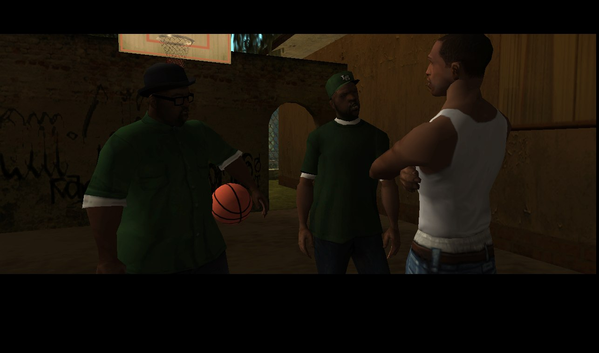
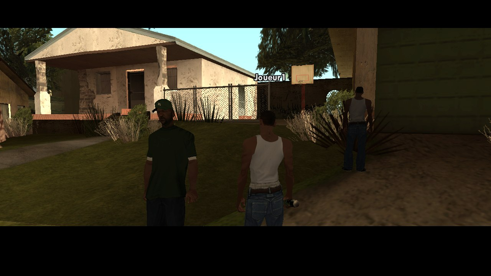
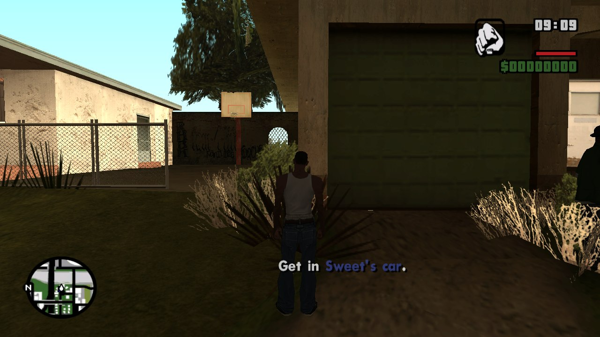
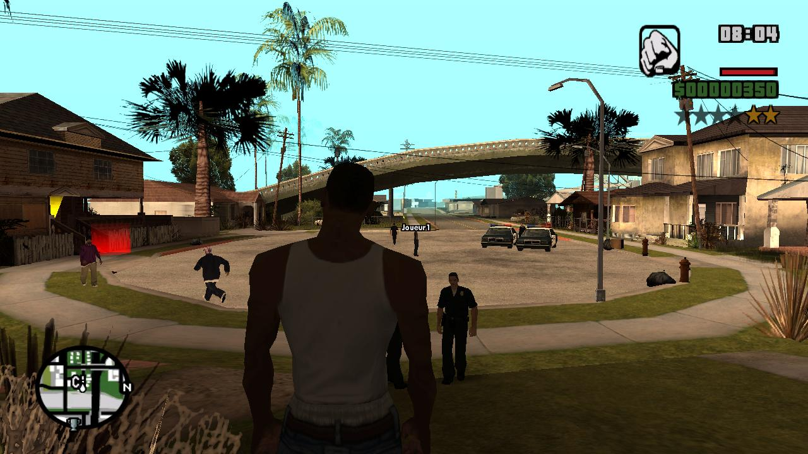
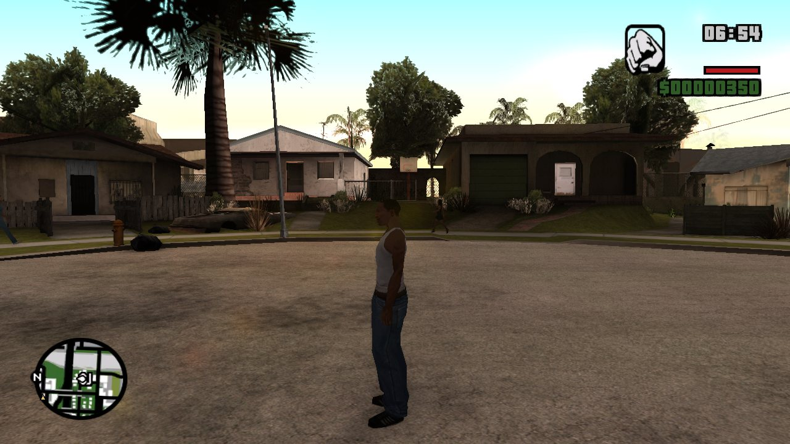
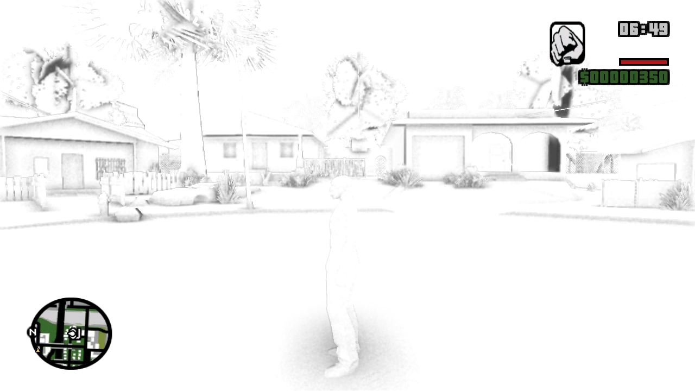
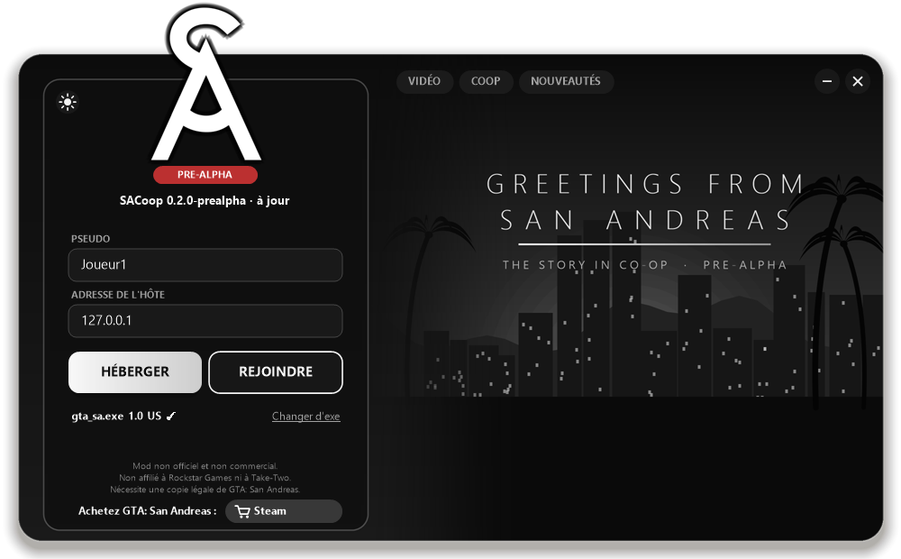
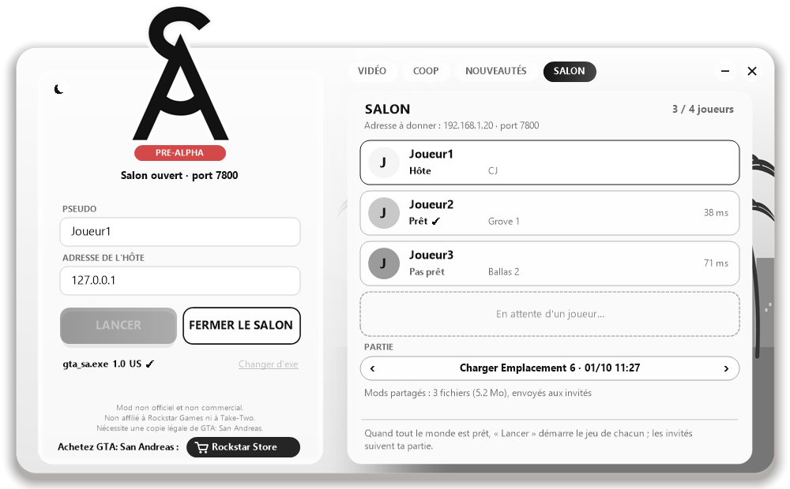

<p align="center">
  <picture>
    <source media="(prefers-color-scheme: dark)" srcset="docs/img/logo.png">
    
  </picture>
</p>

<p align="center">
  
  <a href="https://github.com/zebra032-cyber/SACoop/releases"></a>
</p>

<p align="center">
  <a href="https://store.rockstargames.com/fr/game/buy-grand-theft-auto-the-trilogy"></a>
</p>
<p align="center">
  <b>This mod needs a legitimately owned copy of Grand Theft Auto: San Andreas.</b>
  <a href="https://store.rockstargames.com/fr/game/buy-grand-theft-auto-the-trilogy">Buy it on the Rockstar Store</a> (also on Steam). No game data is included here.
</p>

> [!WARNING]
> **PRE-ALPHA.** Shared story missions, vehicles, combat and saves already work, but the mod has not been played
> for real between friends for long. Expect bugs, and send your logs (`sacoop.log`, `logs` folder).

# SACoop: the San Andreas story in co-op — Zebra's forked repo

A co-op mod for **Grand Theft Auto: San Andreas** (PC, version 1.0 US). One player hosts and plays the story, friends
join the same world and the same missions, with modern options on top.

**This is Zebra's fork of [Parricidium/SACoop](https://github.com/Parricidium/SACoop).** It is the `vcport` line: the
same mod, plus the robustness and sync work that made [VCCoop](https://github.com/Parricidium/VCCoop) (the Vice City
co-op by the same author) so smooth, plus a long list of fixes and new features (see
[Everything this fork adds](#everything-this-fork-adds)).

## Thank you, Parricidium

**A very big thank you to [Parricidium](https://github.com/Parricidium)** for creating SACoop and VCCoop. Everything in
this repository stands on their work: the networking, the mission mirroring, the launcher, the in-game menu and the
whole design of the mod are theirs. This fork only exists because they built something worth building on, and a
brother and I got to play San Andreas together because of it. Thank you for making it, and for the years of
reverse-engineering behind it.

If you like this, go and star the original: **<https://github.com/Parricidium/SACoop>**.

<p align="center">
  
</p>
<p align="center"><i>A guest watches the cutscene of the host's mission (Big Smoke), at the same time as the host.</i></p>

<p align="center">
  
  
</p>
<p align="center"><i>On the guest: the mission camera with Sweet and the host, then the mission's own texts, in widescreen.</i></p>

<p align="center">
  
</p>
<p align="center"><i>A wanted guest: the host's cops come for them too (Grove Street).</i></p>

<p align="center">
  
  
</p>
<p align="center"><i>Optional modern rendering: ambient occlusion and FXAA (right: the occlusion alone).</i></p>

## Contents

1. [Quick start](#quick-start)
2. [Everything this fork adds](#everything-this-fork-adds)
3. [What the mod does (full feature list)](#what-the-mod-does)
4. [Keys](#keys)
5. [Settings (`sacoop.ini`)](#settings-sacoopini)
6. [The launcher](#the-launcher)
7. [Testing checklist and sending logs](#testing-checklist-and-sending-logs)
8. [Building from source](#building-from-source)
9. [Publishing your own build to GitHub](#publishing-your-own-build-to-github)
10. [Known gaps and roadmap](#known-gaps-and-roadmap)
11. [Credits and license](#credits-and-license)

## Quick start

1. You need GTA San Andreas **1.0 US**. The current Steam version (3.0) must be downgraded first (a downgrader tool
   does it). The mod refuses to run on any other version.
2. **Both players must run the same build** of `dinput8.dll` (the network messages changed in 0.49, 0.52, 0.53 and 0.54; a
   mismatched pair is refused). Either:
   - download the zip from this repository's **Releases** page and copy its contents next to `gta_sa.exe`, or
   - build it yourself (see [Building from source](#building-from-source)) and copy `build\dinput8.dll` over the
     `dinput8.dll` in the game folder, **on both machines**.
3. Start the game with **`SACoop.exe`** (the launcher) or with the shortcuts `SACoop - Heberger.cmd` (host) /
   `SACoop - Rejoindre.cmd` (join).
4. The host clicks **HOST** (it opens the lobby). The others type the host's IP address, click **JOIN**, then
   **READY**.
5. The host picks a new game or a save and clicks **START**: every game starts, and guests follow the host (same save
   when they have it). Over the Internet, the host opens port **7800** (TCP and UDP) on their router, or you use a
   virtual LAN. A player who arrives after the start uses **JOIN IN GAME**.
6. Check that the first line of `sacoop.log` says `SACoop 0.54.4-vcport (Zebra's forked repo) loaded`. If it does not,
   that machine is running another DLL.

> [!IMPORTANT]
> The `SACoop.exe` launcher updates the mod by itself on every start. **Zebra's fork launcher** (this repository's
> version) checks *this* repository's releases. An `SACoop.exe` built from the original repository checks the
> original's releases instead, and could replace the fork's `dinput8.dll` with the original release. Use the
> `SACoop.exe` from this fork's zip or from `build-exe.cmd` / `build.cmd`.

Uninstall: delete `dinput8.dll`, `SACoop.exe`, the `SACoop` folder, `sacoop*.ini`, `sacoop.log` and `logs\`.

## Everything this fork adds

Versions are `0.49.0-vcport` to `0.54.4-vcport`; the original's last release is `0.48.4-prealpha`. The same list, with
per-version detail, is in [`docs/CHANGELOG.md`](docs/CHANGELOG.md), and the technical notes are in
[`docs/PORT-VCCOOP.md`](docs/PORT-VCCOOP.md).

### Smoother play (VCCoop's robustness layer, 0.49.0)

- **Interpolation:** other players, vehicles and mission characters are shown about 110 ms in the past, between two
  real received states (the last 10 are kept per entity), instead of being extrapolated and snapped. Every vehicle
  and character message now carries a timestamp, and each sender's clock offset is tracked.
- **Placement after the physics step:** remote players, mission characters (on the guest) and vehicle copies are
  placed right after the game's physics, so they no longer jitter or fight the local physics.
- **Frozen vehicle copies:** the local physics can no longer push or bounce the copy of someone else's car.
- **World sanitizer:** a vehicle or character whose position, matrix or speed becomes absurd (NaN...) gets its last
  sane pose back before it can crash the game.
- **Extended mission mirror:** about 120 more mission commands are repeated on the guest (texts, blips, camera and
  fades, mission audio, cutscene helpers, roads, garages, objects, pickups).
- **30 FPS by default** (the original game timing, as VCCoop does). 60 FPS with the frame-rate corrections is still
  there as an option.

### Worlds that match better

- **Radar blip sync:** the host's coordinate and contact blips (the next mission's marker, the ones after a mission...)
  are copied to the guests; during a mission, the guest's map follows the host's strictly, so a joining player no
  longer keeps mission-letter blips the host does not have.
- **Weather and sky:** the guest's game never starts a weather change by itself, so the sky colours at dusk and dawn
  no longer flicker. Clock and weather are not applied during cutscenes.
- **Cutscenes:** the other players' doubles (player copies, mission character copies, vehicle copies) are hidden
  while a cutscene plays, instead of standing in the scene on top of the actors.
- **Vehicles stay:** cars spawned from the F10 menu or by a cheat code are shared, and parked vehicles keep being sent
  while another player is within 350 m (they used to vanish for the other player 10 s later).
- **No overlaps:** when a copy of the host's vehicle is about to appear, an ordinary car of the guest's own traffic
  that is already there is removed (with its occupants), and a copy no longer pops into a player standing next to
  it.
- **Mission vehicle for the guest:** the guest's own copy of the host's mission vehicle is sent to the host the
  moment it spawns, so the host sees it appear.

### Trains

- **Trains are synced.** The host's trains (the random ones and the mission ones) run on every guest's rails: same
  place, same speed, same direction, and they stop at the stations together. Before, every PC ran its own trains.
- Whoever drives a train owns it: a guest who gets in the cab drives it for everybody, and it goes back to the host
  when they get out.
- The guest's own random trains are switched off while the host shares its trains. Setting `TrainSync`.
- Limits: the game only builds trains near the host, so a guest far away from the host sees none; a player inside a
  train is shown standing in it (no seat animation yet); a derailed train is not synced.

### Missions, vehicles and the F10 menu (0.54.0 to 0.54.4)

- **Only the host starts story missions.** A guest who walks into a mission-start marker no longer starts anything,
  but still sees the marker, so a guest can show the host where it is. Setting `GuestMissionLock`.
- **Blips during a mission:** the guest's map now looks like the host's. Mission-start letters and contact icons (OG, BS...)
  that the guest's own game keeps re-creating are removed within a tenth of a second; only the host's objective blips
  and what the mission puts on the map stay.
- **F10 > Tools > SKIP CUTSCENE:** uses the game's own skip; a second click (or a click when the controls or camera are
  stuck after a cutscene) ends it by force and gives the controls and camera back.
- **F10 > Tools > REMOVE MY LAST VEHICLE / REMOVE ALL MY VEHICLES:** removes the vehicles you spawned (menu or cheat code),
  also on the other players' screens at once.
- **Alt+Tab:** leaving the game gives the mouse back to Windows at once (cursor shown and free, no longer held by
  the game); coming back takes the mouse and keyboard again.
- **Alt+Enter** switches between borderless full screen and a window. The game keeps its resolution; the picture is scaled
  into the window. The choice is saved in `sacoop.ini` (`Fenetre`).
- **Helicopter rotors and plane propellers** turn on the other players' screens (they were frozen).
- **Radio in a shared vehicle:** any player in the vehicle can change the station and everybody ends up on the last choice
  (the driver's game decides when several people change it at once). Track and position still follow the host's radio.
- **Home Invasion fixes (to be confirmed in play):** a guest moved into the host's interior now has the scenery and
  collisions loaded around them (no more sky-only view and fall), the host's scene loading (`LOAD_SCENE`) is repeated
  on the guest, and a player stuck still in the jump-landing animation for 2.5 s is freed automatically.
- **Home Invasion, second round (0.54.1, from the two logs of 14/10):** the guest was put into the interior before the game
  had loaded its collisions, fell 40 m, was "rescued" back outside, and the host's interior scene then played around
  nobody (sky only, the old man falling). Now a player put into an interior is held in place until there is ground under
  him; a fall rescue inside a mission goes to the host's interior, not back outside; and during a host mission a guest who
  is not in the host's zone for 4 s is put next to him. The stuck-landing check also reacts after 1.2 s following a
  teleport. The help text keys are looked up on the guest and logged (the table is reloaded if a key is unknown).

- **Third round (0.54.2, from the 0.54.1 logs of 14/10):** the **radio** of a shared vehicle now really retunes the driver's
  radio when a passenger changes the station (before, only the station number changed and the music did not). The guest's
  **radar** loses the contact icons during a host mission (the guest's game is told it is "on a mission", as the host's
  is; it is put back when the mission ends). **Alt+Tab** shows the cursor again whatever the game did to its hide
  counter, and the cursor over the game window is an arrow while it is in the background. A player held in place while
  the scenery loads is no longer "freed" by the stuck-landing check, and a guest who falls after the host went back
  outside is put next to the host outside. The mission people the host placed with a script no longer show the falling
  pose on the guest. A **"commandes :"** line in the log says what the game sees when the player pushes a direction and
  does not move (for the "cannot move left or right after the cutscene" bug).

- **Fourth round (0.54.3, from the 0.54.2 logs of 14/10):** a guest who is **in a vehicle** when the host's script moves
  the player (a mission cutscene, the move into an interior) is now taken out of it on the spot - no exit animation, no
  damage, the vehicle stays where it is - and arrives with the host, instead of watching the interior from outside. What
  the host does **by himself** afterwards (walking through a door) is no longer followed: after the scripted move the
  guest is only brought back to the host's zone for a few seconds if he did not make it, and each player then goes in
  and out of interiors when he chooses (the guest used to be dragged out and back in 4 s after the host). The guest's
  zone fields (visible area, ped area) are always set together. The host's **clear-area** commands (cutscene set-up)
  now also clear the guest's own passers-by and parked cars there (extra pedestrians next to the van). When the host's
  CJ takes out his **phone**, the guest's does too, and the call's dialogue is mirrored even from non-mission scripts
  while the phone is out (`telephone :` log lines tell which script starts a call). The launcher **lobby ping** is
  measured with a high-resolution clock, one send per message and no Nagle delay, first measured right on arrival
  (shown as "..." until then), once a second, smoothed, and not while a guest downloads the host's mods. New log line
  `objet porte :` for the crate-drops-when-crouching bug.
- **0.54.4:** a guest leaving the house at the start of a session was left outside with no scenery at all (0.54.3 forced
  the interior's zone back during the game's own exit transition); that extra zone check is gone, and the "back to the
  host's zone" step waits for the game's entry/exit transition to end.

### Players

- **Ping:** every player's ping to the host shows on the **F5** board and in the **F10 > Players** tab. Ping is timed
  by a separate network thread (it used to include the game's frame delay and read far too high), and the host shares
  everyone's ping.
- **Radio sync (experimental):** when you are tuned to the same station as the host, you hear the same song at the
  same point in it, and the same adverts. The custom "User Tracks" radio syncs too when both players have an identical
  track library (checked automatically; if the libraries differ you get a message and no sync).
- **Weapons kept on death:** the weapons you held come back (with their ammo) about 1.5 s after you respawn, instead of
  being lost. Only what is missing is given back.
- **Go to player:** teleporting to another player works from anywhere, including inside interiors: the right interior
  is selected, the scenery is loaded on the spot, and you leave your vehicle first.
- **Where I died:** **F10 > Players > "Where I died" > GO THERE** takes you back to your last death spot.
- **Endless-fall rescue:** a player who falls under the world, or falls for a long time without a parachute or jetpack,
  is put back on their last safe position (or next to the host).
- **Falling animation fixed:** after leaving an interior (a safe house...) or teleporting, the other players no longer
  see your character stuck in the falling animation until you move.
- **Pause indicator:** a player in the pause menu stands still for the others and shows "(paused)" next to their name.
- **F10 and F1 keys:** holding the key no longer makes the menu flicker open and shut.
- **Save disk:** picking up a save disk no longer opens the save menu for the other players too.

### Stability and diagnostics

- Fixed a crash when opening Display Setup > Advanced.
- **Core-0 CPU affinity** at launch (setting `AffiniteCoeur`): fixes the mouse cursor that drifted.
- **Load diagnostics** in the log every 10 s: CPU per thread, process and machine, disk reads, the heaviest
  processes, plus an optional sampling profiler (`Profil=1`).
- Many new log lines (`radio:`, `relocated:`, `death:`, `network: ping ...`, `radar:`, `teleportation`, `sanitizer:`)
  so a problem can be traced from the two `sacoop.log` files.

### Fork tooling

- The launcher updates from **this** repository's releases (`zebra032-cyber/SACoop`) and shows "Zebra's forked
  repo" under the logo and in its window title. The F10 menu header and the first line of the log show it too.
  A repository with no release yet counts as "up to date", not "offline".
- `build-dll.cmd` and `build-exe.cmd` find Visual Studio 2019 to 2026 by themselves; `build.cmd` builds both.
- `dist\make-release.ps1` publishes to this fork by default (`-Repo` to change it).

## What the mod does

Everything below comes from the original SACoop and still works.

- Host and join over UDP (default port 7800), up to 4 players.
- Each player sees the others as **CJ wearing that player's own clothes** (shops and wardrobe included), walking,
  running and sprinting with the game's animations, in the right place. A pedestrian model can be picked instead.
- **Shared vehicles:** whoever drives a car sends it to the others, who see it move with that player's CJ at the
  wheel (or as a passenger). Getting into someone else's car and driving off hands it over to you.
  Everybody sees the others open the door and get in or out, and the car's damage (doors, bumpers, lights,
  tyres, smoke, fire, explosion), siren and repairs.
- Each player's **name above their head** and a **radar blip** in their colour.
- **Same time and weather** for everybody (the host's).
- **Mission vehicles for everybody:** when the host takes a mission vehicle (the bikes of Big Smoke's mission...),
  each guest nearby with no free seat in it gets the same vehicle next to them (or a reminder to ride along with G).
- **Police for everybody:** one wanted level for the group (the highest; losing the police clears it for all), and
  the host's cops also hunt down wanted guests near the host (their hits land on the guest).
- **Merged street life:** the host populates the streets around them (110 m) and everybody sees the same
  pedestrians and traffic there; further out, the nearest player populates. A guest a bit away from the host keeps
  live streets on their side, with nothing doubled or vanishing in front of anyone.
- **Weapons and shots:** everybody sees the weapon in each player's hand and their shots. Players can hurt each
  other (bullets, punches, cars; *Friendly fire* option, each player chooses), and a player who dies falls for
  everybody, then comes back at the hospital.
- **Shared story missions:** missions run on the host, everybody plays them. The other players see the mission
  characters (Sweet, Big Smoke... with their weapons, in their cars), vehicles and objects, the **cutscenes** (skipped
  together when the host skips), mission texts, help boxes, radar markers, dialogues, fades and mission cameras. They
  can fight alongside the host: their hits on mission characters count, and mission enemies hurt them. **Any player
  can move the mission on**: reaching a checkpoint or getting into the mission car counts for everybody, and
  checkpoint markers show for all. At mission start, far-away players are brought behind the host. **Shared story
  progress:** what the host's missions unlock is sent to everybody, and money earned in missions goes to each player.
  A player joining in the middle of a mission gets its markers and texts. **Shared save:** when the host saves, the
  save goes to every player's same slot. Side activities stay local to each player.
- The pause menu no longer freezes the world while other players are connected, and switching windows does not
  pause the game.
- **Shared mods:** put car, weapon or character mods (`.dff`, `.txd`, handling lines...) in `SACoop\mods`; the host
  sends them to the guests in the launcher lobby, and everybody plays with the host's mods.
- **COOP menu in the game** (main and pause menus): host, join an address, change your name, see the session.
- **Original game, further** (launcher VIDEO tab or F10 > DISPLAY, applied right away): draw distance up to 250%
  (detailed scenery, horizon and fog further away), population area (how far pedestrians and cars appear) and density,
  anisotropic filtering.
- **Modern rendering** (optional): ambient occlusion (corners, wall bases, under cars darker) and FXAA anti-aliasing.
- **Widescreen:** the 3D, the HUD (radar, icons, texts) and the menus keep their proportions on wide screens, with a
  wider field of view (Hor+). Borderless mode picks your screen's resolution by itself.
- **60 FPS option:** the original game's frame-rate bugs (swimming, braking, doors, helicopter rotors, pushing cars...)
  are fixed with the fixes of [Framerate Vigilante](https://github.com/GTAmodding/FramerateVigilante) (MIT), ported
  into SACoop, with automatic 30/50 FPS caps where the game still needs them (pool, girlfriend, DRUGS1 indoors).
  Set `ImagesParSeconde=60` to use it; the default is 30.
- Windowed or borderless play, logos and intro videos skipped.
- Settings and saves kept in the game folder, apart from your solo saves.
- Two copies of the game can run on the same PC (the game normally refuses).

## Keys

| Key | What it does |
|-----|--------------|
| **G** (also **F**) | Ride as a passenger in another player's car |
| **T** | Chat (Enter to send; `/join` brings you back next to the host) |
| **F5** (hold) | Players board: name, health, distance and ping |
| **F6** | First-person view on foot |
| **F10** | In-game menu, used with the mouse: **Players** (go to a player, where I died, friendly fire, ping), **Vehicles** (3D thumbnails, a click spawns it in front of you), **Tools** (health and armour, weapons, money, repair, clear wanted level, jetpack, skip cutscene, remove my vehicles), **Outfit**, and for the host **World** (time, weather) and **Host** settings |
| **F1** | Help (keys, tips) |
| **Alt+Enter** | Borderless full screen <-> window |

## Settings (`sacoop.ini`)

The file is next to `gta_sa.exe`, section `[SACoop]`. Both players should use the same values for the network and
sync options. **The key names are still the original French ones**; they are explained here.

| Key (default) | What it does |
|---------------|--------------|
| `Fenetre=2` | Window mode: 2 = borderless fullscreen (recommended), 1 = windowed, 0 = the game's own fullscreen |
| `ImagesParSeconde=30` | Frame rate. 30 = smooth and stable (like VCCoop); 60 turns the frame-rate corrections back on (more fragile). Use the same value on both PCs |
| `SansIntro=1` | Skip the logos and the intro video |
| `GrandEcran=1` | Widescreen: 3D with the screen's proportions and a wider field of view |
| `SauvegardesLocales=1` | Settings and saves in the game folder, apart from your solo saves |
| `Tenue=0` | Your outfit: 0 = CJ with your clothes, 1 to 299 = a pedestrian of the game |
| `TirAmi=1` | Friendly fire: 1 = other players can hurt you, 0 = no (each player chooses for themselves) |
| `VuePremierePersonne=1`, `ToucheVue=F6` | First-person view on foot, and its key |
| `OcclusionAmbiante=1`, `Anticrenelage=1` | Modern rendering: ambient occlusion and FXAA |
| `ModsPartages=1`, `MemoireStreaming=256` | Shared mods (folder `SACoop\mods`), and the streaming memory in MB when mods are loaded |
| `RecherchePartagee=1` | One wanted level for everybody (the highest) |
| `PoliceHote=1` | The host's police also chase wanted guests |
| `Port=7800` | UDP port of the host (open it on the router to play over the Internet) |
| `Interpolation=1`, `DelaiInterpolation=110` | Show other players and vehicles ~110 ms in the past, between received states |
| `PlacementPietons=1`, `PlacementVehicules=1` | Place remote characters / vehicle copies right after the game's physics |
| `GelerCopies=1` | Local physics cannot push vehicle copies |
| `GardeFou=1` | World sanitizer: fixes absurd (NaN) vehicles and characters before they crash the game |
| `MiroirEtendu=1` | ~120 more mission commands repeated on the guest |
| `CacherEnCinematique=1` | Hide the network doubles during cutscenes |
| `MarqueursRadar=1` | The host's coordinate and contact blips are copied to the guests |
| `SecoursChute=1` | Fall rescue: a player under the world, or falling endlessly, is put back on a safe spot |
| `ArmesMort=1` | Weapons are kept on death (given back after the respawn). 0 = lost, like the original game |
| `GuestWeatherGuard=1` | The guest never changes the weather by itself (no more sky colour flicker) |
| `RadioSync=1` | Guests follow the host's radio (station, track, position, adverts) |
| `GuestMissionLock=1` | A guest cannot start a story mission by walking into its marker (the marker is still drawn); only the host starts missions. 0 = like before |
| `TrainSync=1` | The host's trains run the same on every guest's rails; the guest's own random trains are off. 0 = every PC runs its own trains |
| `Profil=0` | 1 = sampling profiler for stutter hunting (the log always carries the 10 s load report) |
| `AffiniteCoeur=0` | CPU core the game is limited to at launch (0 = first core; fixes the drifting mouse cursor), -1 = no restriction |

If the build is worse than before, switch the new keys off one at a time (set them to `0`), starting with
`GardeFou`, then `Interpolation` with `PlacementVehicules`, `GelerCopies`, `PlacementPietons`, `MiroirEtendu`.
`docs/PORT-VCCOOP.md` has the details.

## The launcher

`SACoop.exe` updates the mod by itself from this repository's Releases page on every start, checks your game
version, and starts the game as host or guest. Its tabs hold the lobby, your outfit (3D preview; CJ with his clothes
or any of the game's ~265 pedestrians: gangs, police, everyone in the streets), your mods (on/off, 3D preview), the
options and the release notes; the round button at the top right of the left panel opens the logs of your last 50
sessions (to send when something goes wrong).

**Lobby:** HOST opens a lobby; the others JOIN it with the host's address and click READY. The host picks a new game
or one of their saves, then START launches everybody's game at once (sounds when a player joins, leaves or gets
ready).

<p align="center">
  
  
</p>

## Testing checklist and sending logs

Versions 0.49 to 0.54 have been written and checked for build errors, but are still being tested in real play. If you
want to help, play a session and look at these:

- [ ] The first line of **both** `sacoop.log` files shows the same version (`0.54.4-vcport (Zebra's forked repo)`).
- [ ] **Ping** shows in F5 and F10 > Players and looks like the real ping (a few ms on the same PC or network).
- [ ] The **sky** no longer flickers at dusk and dawn.
- [ ] After a **teleport** or leaving a safe house, the other player is not stuck in the falling animation.
- [ ] A mission **vehicle for the guest** appears for the host as well.
- [ ] The guest's **map** has no extra mission-letter blips during a mission.
- [ ] **Die** with weapons: you get them back about 1.5 s after the respawn.
- [ ] **Radio:** the same station, then wait for a song change and an advert; try the custom radio with the same
      "User Tracks" on both PCs.
- [ ] **Missions:** a guest standing in a mission-start marker starts nothing; the marker is still drawn. During the host's
      mission the guest's map shows no other mission letters (OG, BS...).
- [ ] **F10 > Tools:** skip a cutscene; spawn a car, remove it (also gone for the other player); spawn two and remove all.
- [ ] **Alt+Tab** away and back: the mouse works at once. **Alt+Enter** toggles full screen / window.
- [ ] **Helicopter:** the other player's helicopter has turning blades (also on the ground with the engine on).
- [ ] **Radio in a car:** the passenger changes the station, the driver changes it again: both end on the same one.
- [ ] **Home Invasion:** the guest sees the interior and the sleeping man; the host is not stuck after the jump.
- [ ] **Trains:** stand next to a railway (Market station in Los Santos is handy) on both PCs: the same train, in the same
      place, on both screens; try driving one from the guest and from the host. The logs say `trains:` for each train.

When something goes wrong, send **both players' `sacoop.log`** (next to `gta_sa.exe`; older sessions are in `logs\`,
or use the launcher's logs button) and say roughly when it happened. Useful log lines start with `radio:`,
`relocated:`, `death:`, `network:`, `radar:`, `sanitizer:` and `teleportation`.

## Building from source

You need Visual Studio 2019 to 2026 with the **Desktop development with C++** workload (x86, `/MT`), nothing else.

| Script | What it builds | Output |
|--------|----------------|--------|
| `build-dll.cmd` | the mod only (finds Visual Studio itself; log in `build\build.log`) | `build\dinput8.dll` |
| `build-exe.cmd` | the launcher only (log in `build\build-exe.log`) | `build\SACoop.exe` |
| `build.cmd` | both | the two files above |

Copy `build\dinput8.dll` over `dinput8.dll` in the game folder, **on both machines**, and `build\SACoop.exe` next to it
if you changed the launcher. `launcher\make-art.ps1` draws the launcher's background and icon. `run\` holds the
two-instance test scripts, `re\` the command-line Ghidra tools used to read the game.

The game executable and any decompiled code are **not** in this repository.

## Publishing your own build to GitHub

From the folder of your clone (for example `C:\sacoop`), with the fork as the `fork` remote:

```bat
git remote -v
git add -A
git commit -m "Describe what changed"
git push -u fork vcport
```

To make this README and the code the default view of the fork, also update its `main` branch:

```bat
git checkout main
git merge vcport
git push fork main
git checkout vcport
```

To publish a release that the launcher can download (zip with `dinput8.dll`, `SACoop.exe` and the config files),
with the [GitHub CLI](https://cli.github.com/) installed and logged in (`gh auth login`):

```powershell
.\dist\make-release.ps1 -Version 0.54.4-vcport -Publier -Notes "What is new in this version"
```

Without the GitHub CLI, run the script without `-Publier`, then on GitHub use **Releases > Draft a new release**, tag
`v0.54.4-vcport`, tick *pre-release*, and attach `dist\out\SACoop-0.54.4-vcport.zip`.

## Known gaps and roadmap

1. Story missions: testing every mission with real players.
2. Police cars ramming guests' cars (cops on foot already chase them).
3. More modern rendering (sun shadows, reflections, as in VCCoop), all optional.
4. Radio: the track and its position follow the host's radio, so two guests in the same car while the host is on foot
   are on the same station but not necessarily on the same song. Radio sync is a first version: expect a small hiccup now and then when a song changes.
5. Train sync is a first version: a player inside a train is not seated, and the game only builds trains near the host.
6. The `sacoop.ini` key names, the in-game log lines and some code comments are still in French; the in-game menus
   and the launcher show French or English by your system language.
7. Not ported from VCCoop on purpose: ragdoll sync, on-screen timers and counters, model-loading commands,
   `CLEAR_AREA`, trains, roadblocks.

## Credits and license

- **[Parricidium](https://github.com/Parricidium)**: creator of SACoop and VCCoop. Thank you!
- Zebra and their brother: testing, bug reports and the `vcport` fork.
- San Andreas 1.0 US addresses: read with Ghidra in the game executable, cross-checked with
  [plugin-sdk](https://github.com/DK22Pac/plugin-sdk) (DK22Pac) and the
  [gta-reversed](https://github.com/gta-reversed/gta-reversed) project.
- 60 FPS fixes: [Framerate Vigilante](https://github.com/GTAmodding/FramerateVigilante) (MIT).
- Grand Theft Auto and San Andreas are trademarks of Rockstar Games / Take-Two Interactive. This is an unofficial,
  non-commercial fan project, not affiliated with them. You must own the game.
- License: not chosen yet.
